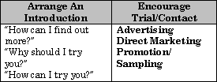
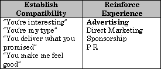
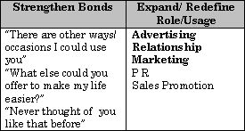

Before assessing the communication task and the best medium, it is worthwhile considering exactly how the communication will work on the audience and what medium may be particularity suitable for this.

Most media can fulfil many roles but there are some media that should definitely be considered for particular communication tasks. Those in bold have a really strong edge in each area.

*(The first chart of this series was not archived.)*

*(The last chart of this series was not archived.)*
