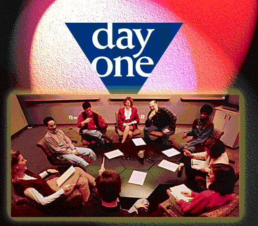

## What it is:

Brand Assets and Key Discovery analysis are proprietary JWT tools for understanding our Brand's situation. Day One is a proprietary JWT process for helping the Brand Team use these tools to develop a Brand Vision and overall communications strategy.

## What its for:

Creating our Brand Vision and strategy is not just the role of the Planner or Account person, it's the job of the whole team --- at the agency and at the client. Day One is designed to bring these diverse people together for a day long work session in which they put themselves in the consumer's shoes to help make the most powerful connection between the brand and the consumer.

## How to do it:

Who attends? Ideally, the whole Brand Team... from the most junior to the most senior person involved , in Brand communications, all attend the Day One. This, of course, includes not just Agency people but clients as well, form senior management, to marketing and sales, to research and development. It may also include other communication specialists working on the brand. The more people who are involved in the process, the broader and deeper the team's understanding of our strategy. And, because Day One involves both creatives and clients directly in the strategy development process, strategies can be both more creative and easier to gain acceptance by client organisations.

One critical point for a successful Day One is that titles and functional responsibilities need to be left at the door. In a Day One, everyone is equal ..a communications problem - solver trying to think and feel like the consumer.

- [Day One Structure](./day-one-structure.md)
- Day One Worksheet *(not archived)*
- [Practical Guidelines](./practical-guidelines/index.md)
