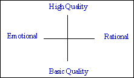
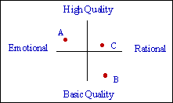
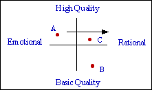

The Brand Map Tool allows you to place your brand and competitors against criteria you believe distinguish brands from each over and drive the market. The tool allows you to manipulate both the criteria which shape the market, and the direction you feel the brand might take to better meet these key criteria.

## Example

To use it, put in the criteria which polarise/distinguish the market.

Then, using research based insights, qualitative or quantitative, place the key competitors on the map.

Analysis has revealed that Brand A, your brand, is an emotional purchase and high quality, but brands which are more rational purchases are growing faster.

The map enables you to plot, where clearly the brand should compete to take advantage of this - its *desired positioning.*

